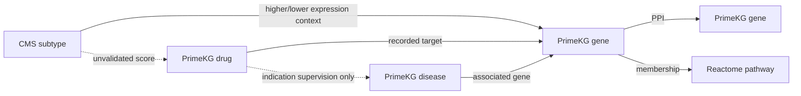

# CRCSC–PrimeKG GNN drug-hypothesis prototype

## Verdict

**Technical integration and exploratory scoring executed. Popularity exceeds every fitted GNN in this run. Meaningful subtype-specific drug prioritization remains unvalidated.** Do not present these scores as treatment recommendations, efficacy probabilities, or literature-novel discoveries.

The full PrimeKG CSV is referenced read-only. A small typed CMS overlay is exported and compiled into the runtime molecular graph. This avoids copying the 8.1M-row graph while preserving the original broader KG for future evidence retrieval. The encoder uses a selected gene/PPI/pathway/drug/disease view; phenotype and other PrimeKG relations do not enter this model. The working agent remains pinned to its earlier reviewed CRC backend; it has not silently switched to CMS results.

## Integration and semantics

- Four new `crc_cms_subtype` nodes (CMS1–CMS4) bridge through **400 discovery-selected expression edges** to existing canonical NCBI gene nodes.
- `higher_expression_signature` and `lower_expression_signature` remain distinct relations. Both signed weight and magnitude, adjusted discovery effect, FDR and source are saved. We do not reinterpret them as mutations, causal dependencies, or therapeutic indications.
- Exact `(type, source, id)` aliases are canonicalized before training. The base-node audit preserves original indices and canonical representatives. The compact graph has 27,610 genes, 6,282 drug nodes in the matched evaluation universe and 5,690 direct-target-supported hypothesis candidates.
- PPI: 642,150 directed messages; gene–pathway membership: 42,646; disease–gene associations: 80,411. The full graph is not relabeled or overwritten.
- Only `drug_protein` display role `target` enters drug pooling. Enzymes, carriers and transporters are not treated as targets. Reciprocal target copies and exact-ID aliases are deduplicated.

| subtype | genes | higher_expression_genes | lower_expression_genes | l1_mass |
| --- | --- | --- | --- | --- |
| CMS1 | 100 | 84 | 16 | 1.0000 |
| CMS2 | 100 | 58 | 42 | 1.0000 |
| CMS3 | 100 | 52 | 48 | 1.0000 |
| CMS4 | 100 | 100 | 0 | 1.0000 |

The source representation is `reports/crcsc/20261108_172638`. Discovery-only profile weights are frozen; validation replication statistics were not used to select drugs or fit model parameters. CMS labels remain distinct from ECoGraph GI genomic subtypes.

## Runtime message-passing view



## Model and the key transfer assumption

We reuse the existing width48 PPI/target/disease pooling architecture and 40-epoch-style training recipe, adding one relation-specific pathway propagation variant. **ppi** uses PPI; **ppi_pathway** adds gene→pathway→gene mean messages; **drug_only** removes molecular disease context from the decoder while retaining drug target/PPI representations. Pathway pooling includes a gene's own pathway membership. These are compact message-passing models, not an end-to-end encoder of all PrimeKG relation families.

Known disease indications train the decoder; no CMS drug labels exist. Therapeutic relations never enter molecular adjacency. At inference, signed CMS weights pool gene embeddings into the shared disease projection. **This transfers a decoder trained on unsigned disease associations to signed expression-derived subtype vectors. That domain-transfer assumption is not validated.** A negative expression weight is not an instruction to inhibit or activate a gene. Signed scoring is exploratory, not a learned pharmacological-direction model.

Prespecified input variants are signed, magnitude-only, higher-expression-only, and lower-expression-only. CMS4 has no lower-expression genes in the selected top100; its empty lower-only profile is a zero-input diagnostic, and no candidate hypotheses are exported from that empty row. Weighted profile changes occur at inference and cannot improve disease-indication test AP in this one-way pooling architecture.

## Matched held-out disease evaluation

All conditions share a seed42 disease split, indication positives, fixed validation/test unknowns, and epoch-specific training unknown pairs. Checkpoint selection uses validation AP only. Split details: `{'train': {'diseases': 633, 'positives': 4229, 'unknowns': 4229}, 'validation': {'diseases': 136, 'positives': 1151, 'unknowns': 1151}, 'test': {'diseases': 136, 'positives': 853, 'unknowns': 853}}`. Sampled unknowns exclude recorded indications, contraindications and off-label relationships; they are not confirmed biological negatives. Disease-family/source overlap remains possible. Candidate drugs remain identical across conditions, including drugs without direct targets for matched evaluation; subtype hypotheses are restricted to direct-target-supported drugs.

| condition | runs | mean_ap | min_ap | max_ap | mean_disease_macro_ap |
| --- | --- | --- | --- | --- | --- |
| drug_only | 3 | 0.8223 | 0.8214 | 0.8239 | 0.8453 |
| drug_popularity | 1 | 0.8941 | 0.8941 | 0.8941 | 0.9218 |
| ppi | 3 | 0.8244 | 0.8223 | 0.8267 | 0.8445 |
| ppi_pathway | 3 | 0.8250 | 0.8225 | 0.8269 | 0.8459 |

Average precision is sampled association recovery, not accuracy or clinical benefit. Three initialization seeds on a single split are not independent cohort replication. Every selected checkpoint should also be checked against the epoch budget in the raw metrics; boundary checkpoints do not establish convergence. Canonical gene indexing differs from the older experiment, so model scores need not numerically reproduce that run; the paired methods within this run have the same inputs/splits. `paired_disease_bootstrap.csv` resamples test diseases to describe AP differences against popularity, conditional on these labels, sampling scheme and fitted models. It does not establish source-independent validation.

## CMS sensitivity and exact ties

**Observed leading group:** the pathway model's signed and magnitude profiles have 29–29 exactly tied leading drugs across all CMS/seed combinations. Their recorded target signatures are `2908` (NCBI2908 is NR3C1). Direct overlap with the selected subtype signatures ranges from 0 to 0 target genes. Zero direct overlap does not exclude indirect graph connections, but these results do not establish subtype-specific therapeutic support. Cross-seed persistence can reflect a stable architectural shortcut rather than reliable biology.

These are inference diagnostics, not therapeutic performance metrics. Top20 sets retain the **entire exact cutoff tie**. Jaccard measures overlap of those inclusive sets; raw logit separation is not efficacy separation.

| condition | profile | tie_inclusive_jaccard | score_spearman | score_rms_difference |
| --- | --- | --- | --- | --- |
| drug_only | magnitude | 1.0000 | 1.0000 | 0.0000 |
| drug_only | permuted_genes | 1.0000 | 1.0000 | 0.0000 |
| drug_only | signed | 1.0000 | 1.0000 | 0.0000 |
| ppi | magnitude | 1.0000 | 1.0000 | 0.1236 |
| ppi | permuted_genes | 1.0000 | 0.9997 | 0.8862 |
| ppi | signed | 1.0000 | 0.9997 | 0.8669 |
| ppi_pathway | magnitude | 1.0000 | 1.0000 | 0.0994 |
| ppi_pathway | permuted_genes | 1.0000 | 0.9997 | 0.8596 |
| ppi_pathway | signed | 1.0000 | 0.9997 | 0.8262 |

| condition | profile | min_top_tie | max_top_tie | min_inclusive_top20 | max_inclusive_top20 |
| --- | --- | --- | --- | --- | --- |
| drug_only | magnitude | 29 | 29 | 29 | 29 |
| drug_only | signed | 29 | 29 | 29 | 29 |
| ppi | magnitude | 29 | 29 | 29 | 29 |
| ppi | signed | 29 | 29 | 29 | 29 |
| ppi_pathway | magnitude | 29 | 29 | 29 | 29 |
| ppi_pathway | signed | 29 | 29 | 29 | 29 |

Drug-level main-effect percentage of total score variance:

| condition | profile | drug_main_effect_variance_pct |
| --- | --- | --- |
| drug_only | magnitude | 100.0000 |
| drug_only | signed | 100.0000 |
| ppi | magnitude | 99.9445 |
| ppi | signed | 96.2320 |
| ppi_pathway | magnitude | 99.9675 |
| ppi_pathway | signed | 96.7050 |

The remaining variance includes subtype offsets and drug-by-subtype interaction; this decomposition is descriptive, not causal. Identical recorded target neighborhoods necessarily produce identical embeddings and scores in this architecture, which lacks compound-specific input features. More selective CMS inputs cannot distinguish those drugs by themselves. See `leading_target_audit.csv` for the actual leading target signatures rather than interpreting arbitrary within-tie ordering.

Zero and identical profiles produce identical subtype score vectors. Swapping profiles swaps prediction vectors (asserted). Gene permutation is a null input: altered scores or rankings do not show biological correctness. The drug-only model must ignore subtype profiles (asserted). `profile_perturbations.csv` and full `scores_*.npz` retain these diagnostics. Within-drug subtype contrasts subtract each drug's four-subtype mean for inspection only; they are not a validated alternative predictor and were not used to select the primary hypotheses.

## Candidate files and downstream literature review

`candidate_hypotheses.csv.gz` contains tie-inclusive top20 drug scores for every actual nonempty profile, fitted condition, seed, and subtype. It includes DrugBank ID, name, raw logit, minimum tied rank, full tie-group size, training-indication popularity, and recorded target signatures. Cross-seed consistency is in `candidate_consensus.csv`; it is not a probability of correctness. Scores from different fitted models are not calibrated or directly comparable in magnitude. Direct signature-target overlap counts are saved with the consensus/queue; zero overlap is absence of a direct recorded connection, not absence of an indirect path or a proof of biological irrelevance.

`literature_review_queue.csv` uses the **prespecified pathway variant** under signed and magnitude profiles, without selecting a model because its test result looks better. It preserves all inclusive candidate groups and leaves evidence fields **NOT REVIEWED**. Sort order prioritizes recurrence across seeds for investigation, not efficacy. **No live literature review has been performed.** Searches should assess:

1. Whether the compound/target association and mechanism are correct, including pharmacological direction and off-target effects.
2. Evidence specifically concerning CRC/CMS versus broad cancer results, and cell-line/animal/patient context.
3. Supporting, null, and contradictory results, dose/exposure, toxicity, and potential tissue-composition confounding.
4. Whether an association is already known; missing graph links or search results do not establish novelty.

Literature may contextualize or weaken a model hypothesis; it does not independently verify clinical efficacy. A genuinely subtype-sensitive ranking needs independent response/dependency labels and a transfer design evaluated against simple baselines. Genomic/microenvironment context, signed expression, and drug action should not be conflated.

## Reproduction and artifacts

```sh
python3 analysis/crcsc_drug_gnn.py
python3 analysis/crcsc_drug_report.py reports/crcsc_drug_gnn/20261108_173948
python3 -m unittest discover -s tests/research -p 'test_crcsc_drug_gnn.py' -v
```

Research requirements plus PyTorch, scikit-learn and threadpoolctl; no API key or download required. New output directories only. The report generator reads completed results and writes report/audit/queue files, without retraining or changing the original experiment. Saved checkpoints require the same audited graph ordering for reconstruction.

Files include `cms_nodes.csv`, `cms_expression_edges.csv`, `base_node_alias_audit.csv.gz`, `profile_gene_audit.csv`, `profile_summary.csv`, `gene_positions.csv`, `disease_split.csv`, `evaluation_pairs.npz`, `evaluation_metrics.csv`, `test_predictions.npz`, `training_curves.csv`, `model_*.pt`, `scores_*.npz`, `candidate_hypotheses.csv.gz`, `candidate_consensus.csv`, `literature_review_queue.csv`, `leading_target_audit.csv`, `tie_audit.csv`, `profile_perturbations.csv`, `subtype_pairwise_diagnostics.csv`, `score_variance_decomposition.csv`, `paired_disease_bootstrap.csv`, and `manifest.json`.

Protected source/representation/notebook/agent/UI hashes unchanged: **True**. This is a prototype integration and hypothesis audit; the output has not been promoted to the agent backend.
